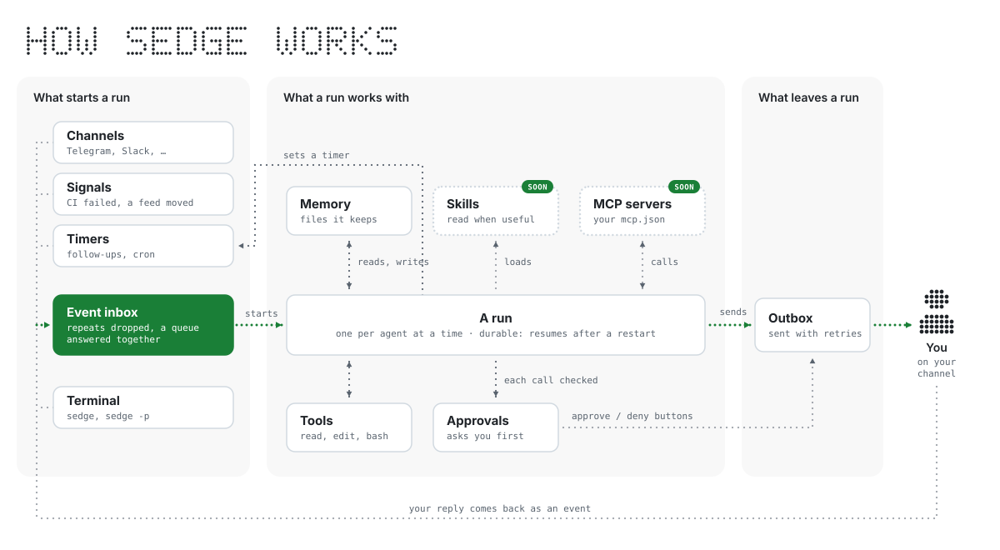

<p align="center"></p>

<h1 align="center">sedge</h1>

<p align="center">An always-on agent that lives on your machine, built on <a href="https://github.com/earendil-works/pi">pi</a>.</p>

<p align="center">
  <a href="https://github.com/sedge-hq/sedge/actions/workflows/ci.yml"></a>
  <a href="https://www.npmjs.com/package/@sedge-hq/sedge"></a>
  <a href="https://github.com/sedge-hq/sedge/releases/latest"></a>
  <a href="LICENSE"></a>
</p>

```sh
curl -fsSL sedge.sh | sh      # or: npm i -g @sedge-hq/sedge
```

```sh
sedge                  # the TUI
sedge -p "…"           # one reply, then exit
sedge start --service  # keep the daemon running across logins
sedge stop
sedge update
sedge pi …             # the agent's own commands (packages, mcp, config, …)
```

Reach it from your phone: in `sedge`, say "set up telegram". It asks for the bot token in a
hidden field, keeps it in your keychain, and gives you a link that pairs your account.

**Channels** are how you and sedge talk (Telegram). **Signals** wake it when something happens
elsewhere, and you say what it should do then: "tell me when my CI fails". Both come as packages
(`sedge install telegram`), and sedge can write a signal for anything else
([`@sedge-hq/kit`](packages/kit)).

<picture>
  <source media="(prefers-color-scheme: dark)" srcset="docs/architecture-dark.svg">
  
</picture>

Behind the TUI, a daemon keeps working after you close the terminal: an inbox of events, timers
it sets itself, memory, approvals you answer from your phone, and updates. Its conversations are
durable ([pi-durable](https://github.com/earendil-works/pi/tree/main/packages/durable)): a run a
restart cuts short picks up where it stopped. The agent is [pi](https://github.com/earendil-works/pi),
bundled; your logins are in `~/.pi/agent`.

**[Read the docs](docs/index.md)**: getting started, how it works, channels and signals, memory,
MCP and skills, security, configuration, and writing your own.

## Develop

```sh
bun install
bun run sedge   # from source, against ./.sedge-dev
bun run check   # lint, format, typecheck
bun run test
bun run e2e:telegram   # the whole Telegram path, against a fake Bot API
```

Releases go out through changesets: `bun run changeset`, merge the release PR.

MIT
