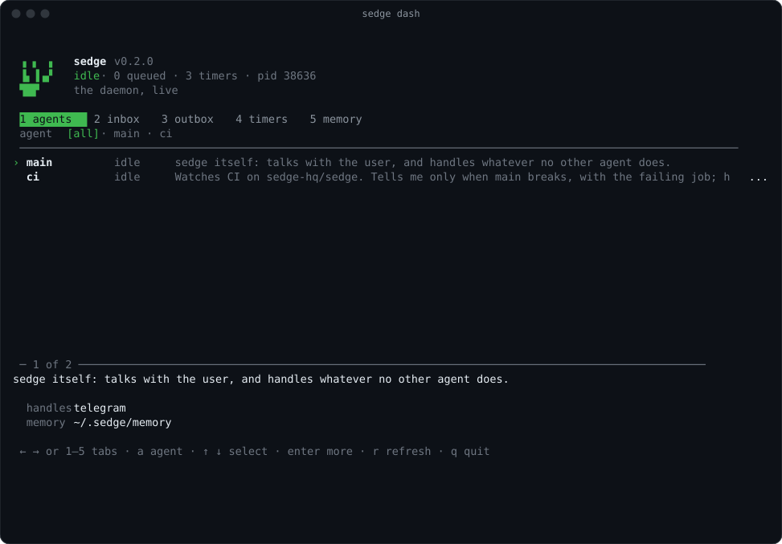
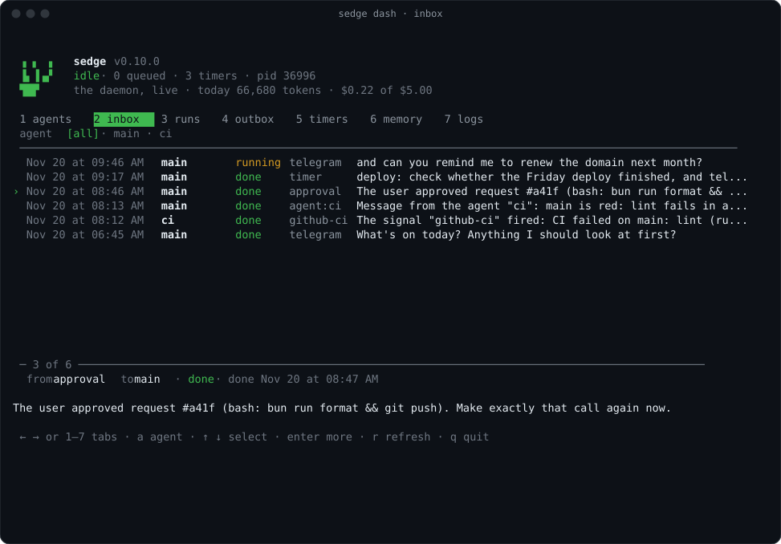
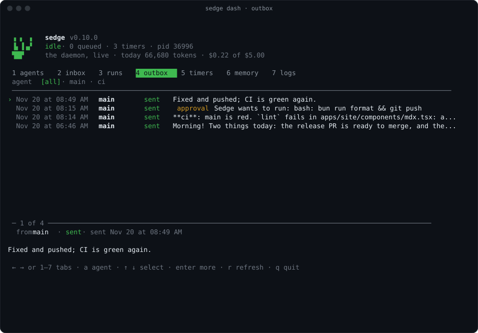
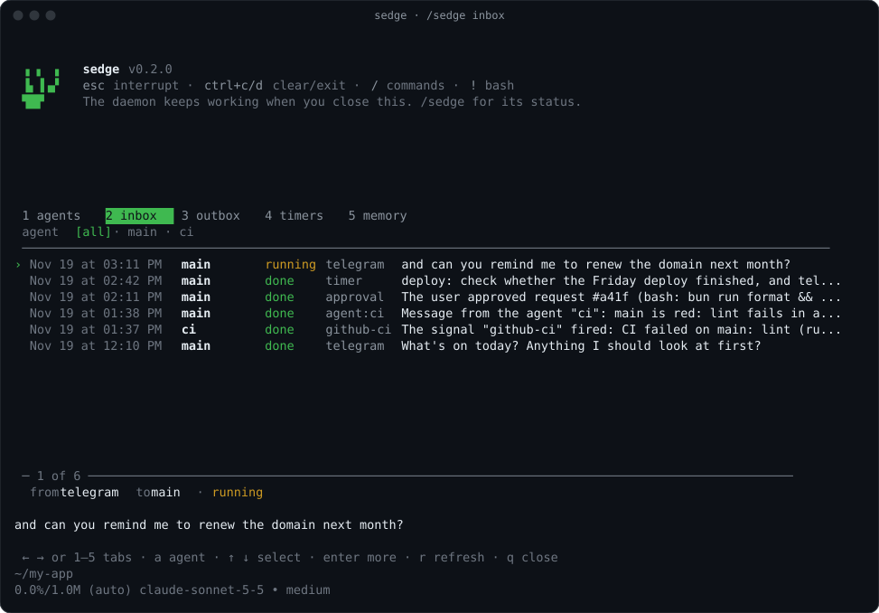

`main` is sedge itself: it talks with you and handles whatever no other agent does. You can add
agents for work that runs on its own: one that watches your CI, one that reads a feed, one that
looks after a project.

## What an agent is

- **A name and a purpose**, in your words: what it watches or does, when to bother you, what to
  hand to `main`. It reads its purpose at the start of every run.
- **Its own conversation**, durable like `main`'s, so its context stays its own.
- **Its own memory**: a folder inside `~/.sedge/memory/agents/<name>/`, with its own `MEMORY.md`.
  The nightly [dream](./memory.md) tidies every agent's memory.
- **The channels and signals you give it.** What they bring wakes that agent instead of `main`.

Agents run side by side, as many as have work, and each one handles one run at a time.

## Make one

Ask in the TUI:

> make an agent that watches the CI signal and only tells me when main breaks

sedge proposes a name and a purpose, shows you, and creates it when you say yes (`create_agent`).
Ask the same way to change its purpose, give it another channel or signal, or remove it.
Removing an agent gives its channels and signals back to `main` and stops its timers; its memory
folder stays.

## How agents talk

Each agent has a `tell` tool. A message from one agent goes into the other's inbox and wakes it,
like any event; the answer comes back the same way. An agent that finds something you need to
know can tell you itself (`send_message`) or hand it to `main`.

Messages from an agent other than `main` reach you with its name in front ("**ci**: main is red
again"), on the channel you last wrote from, or on a channel that belongs to it.

From the TUI you can hand any agent a task and wait for the answer (`tell_agent`), or fire and
forget: `/sedge tell ci check the last three runs`.

## Subagents

An agent can split a job into parts and hand each to a subagent (`subagent`): a helper with a
conversation of its own, started for one task. Ask `main` to check five repositories and it can
start five subagents, one per repository, which all work at the same time.

The agent doesn't wait for them. It ends its run, stays free for your messages, and each
subagent's answer arrives in its inbox as a new event, like a reply to `tell`. A subagent that
fails reports that instead.

A subagent has the tools of the agent that started it, behind the same approvals, and can read
its memory. It can't message you or other agents, set timers or start subagents of its own: it
only does its task and answers. When a call needs your approval, the request comes from the
subagent, and it carries on where it stopped once you answer.

Subagents' runs show up in the inbox under the agent that started them (`main#sub:3f2a9c1d`).
A task started from the terminal can't start subagents, because nobody hears what arrives after
it ends. [`limits.subagents`](./limits.md) caps how many one agent has working at
once, and `limits.runsPerHour` counts an agent's subagents with it.

## See what they're doing

`sedge dash` opens the dashboard full screen, and `/sedge` opens the same one inside the TUI.
Either way there's a tab for each of these:

| Tab      | Shows                                                                                                    |
| -------- | -------------------------------------------------------------------------------------------------------- |
| `agents` | Each agent's purpose, what it handles, whether it's working, its queue.                                  |
| `inbox`  | The events that woke each agent, from where, and how the run went.                                       |
| `runs`   | Each finished run: how long it took, how it ended, its tool calls ([Logs and runs](./logs-and-runs.md)). |
| `outbox` | What each agent sent you, and whether it arrived.                                                        |
| `timers` | Follow-ups and schedules, by agent.                                                                      |
| `memory` | Each agent's `MEMORY.md` and the files beside it.                                                        |
| `logs`   | The daemon's log; `l` steps through levels.                                                              |



← and → (or 1 to 7) switch tabs, `a` picks an agent, ↑ and ↓ select, Enter shows all of the
selected item, `r` refreshes (it also does every two seconds), and `q` closes.
`sedge dash inbox ci` and `/sedge inbox ci` open one tab for one agent.





Inside the TUI it's the same view, over the chat:

 In the chat, the TUI's agent can read the same things for you (`inbox`, `outbox`,
`timers`), and change what an agent remembers if you ask.

## In the config

Agents live in `~/.sedge/config.json` (see [Configuration](./configuration.md)):

```json
{
    "agents": {
        "ci": {
            "purpose": "Watch the CI signal. Tell me only when main breaks, with the failing job."
        }
    },
    "connections": {
        "github-ci": { "kind": "ci", "settings": { "repo": "me/app" }, "agent": "ci" }
    }
}
```
