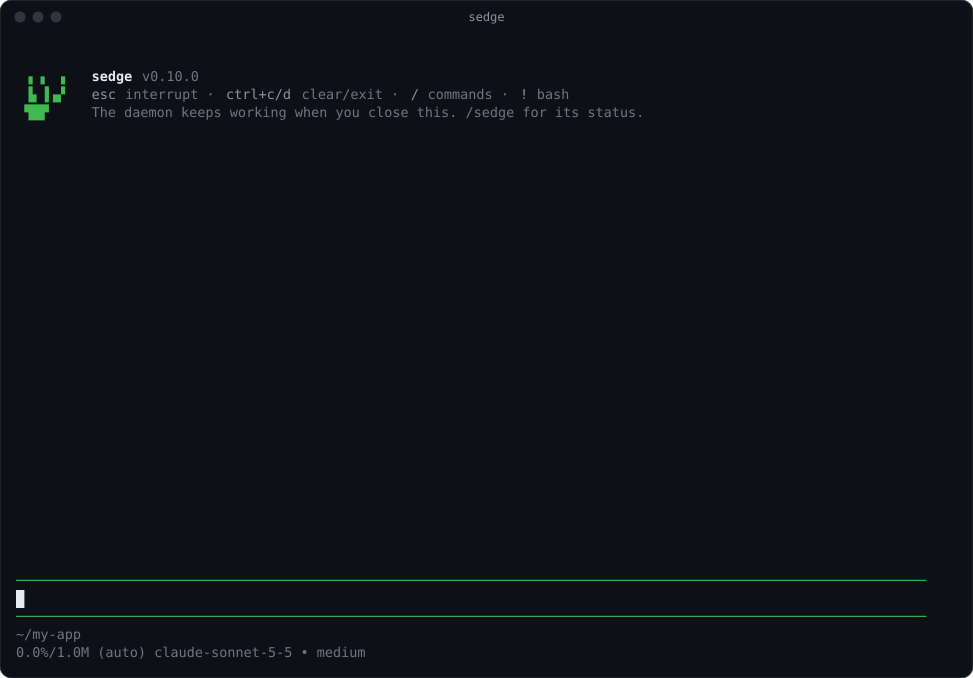

## Install

```sh
curl -fsSL sedge.sh | sh
```

or with npm:

```sh
npm i -g @sedge-hq/sedge
```

Both give you one `sedge` command. It updates itself (see [Configuration](./configuration.md) to
turn that off).

## First run

```sh
sedge
```

This opens the TUI and starts the daemon in the background if it isn't running.


The first time,
log in to a model provider with `/login` (an API key, or a subscription such as Claude). The
daemon uses the same logins and the same default model, so you only do this once.

Ask it anything, as you would any coding agent. For one answer without the TUI:

```sh
sedge -p "summarize the changes on this branch"
```

## Talk to it from your phone

In the TUI, say:

> set up telegram

sedge will:

1. install the Telegram package (you confirm first);
2. ask for your bot token in a hidden field (create a bot by writing `/newbot` to
   [@BotFather](https://t.me/BotFather)); the token goes to your OS keychain, never into the chat;
3. give you an invite link. Open it on your phone: that pairs your Telegram account. The link
   works once and expires in 30 minutes, and nobody else gets answers from your bot.

Now write to your bot. sedge answers there, shows "typing…" while it works, and asks before
anything risky with Approve / Deny buttons.

## Keep it running

The daemon runs until you stop it or log out. To start it at login:

```sh
sedge start --service
```

`sedge stop` stops it and removes the login service.

## Uninstall

```sh
sedge uninstall
```

It lists what it will remove and asks first. It stops the daemon and the login service, deletes
the secrets it kept in your keychain, and deletes `~/.sedge`: memory, conversations, settings,
logs, packages, and the binary if you installed with `curl`. `--keep-data` keeps `~/.sedge` for
a later reinstall.

pi's folder (`~/.pi/agent`, with your model logins, MCP servers and skills) stays. If you
installed with npm, finish with `npm rm -g @sedge-hq/sedge`.

## Next

- Get woken when something happens: [Channels and signals](./channels-and-signals.md).
- See what it keeps between conversations: [Memory](./memory.md).
