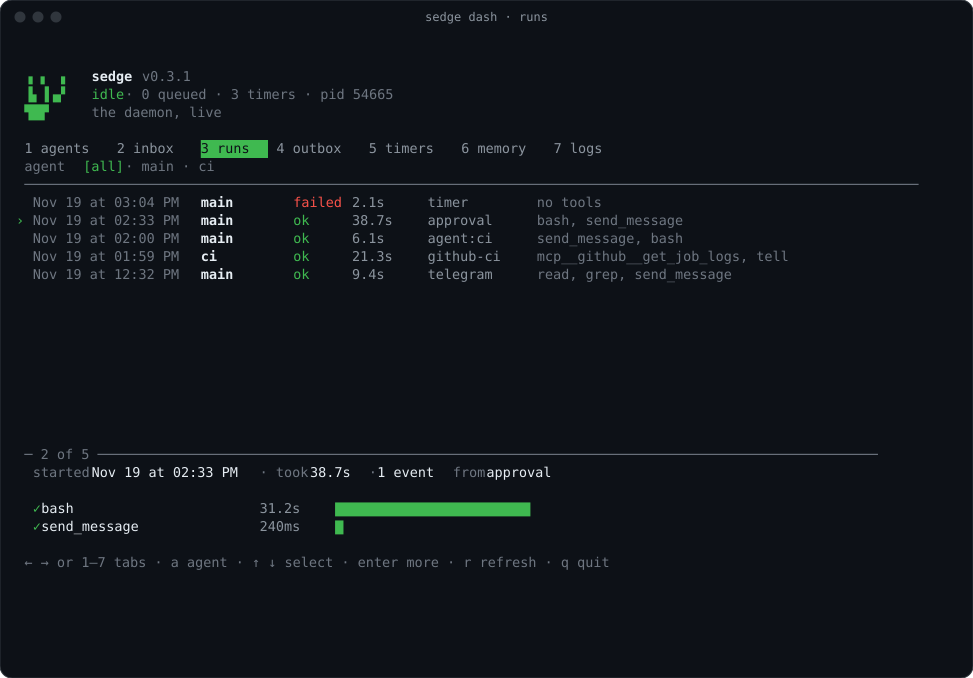
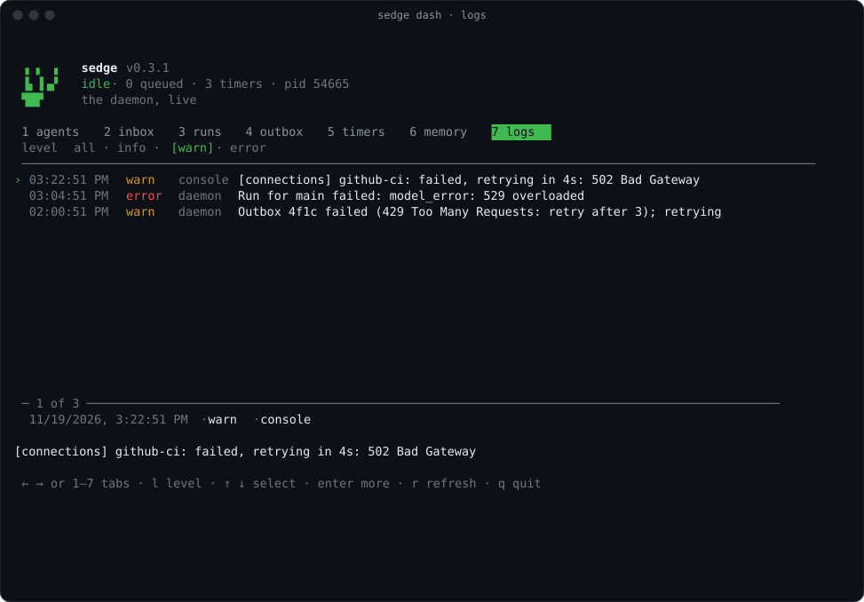

sedge keeps a record of what it does, for you. Nothing is sent anywhere: there is no telemetry to
us or anyone else, and no exporter to turn on by accident.

## Runs

Every run is recorded when it ends:

- which agent ran, and what woke it (a Telegram message, a signal, a timer);
- how long it took, and whether it worked; if not, why;
- each tool call, with how long it took and whether it failed;
- the tokens it used, and their cost at the model's listed price (see
  [Limits and costs](./limits.md)).

`sedge dash runs` (or `/sedge runs` in the TUI) lists them, newest first. Select one for its tool
calls on a timeline.

## Logs

Everything the daemon logs is kept: its own lines, and whatever pi, MCP servers, channels and
signals print. `sedge dash logs` shows them, newest first; `l` steps through levels (all, info,
warn, error).

## Numbers

The dashboard's header counts, since the daemon started:

- runs, and how many failed;
- how long runs take on average, and the slowest.

These are Effect metrics, kept in memory. The daemon also counts tool calls, events by source, and
deliveries.

## Where it's kept

| File                        | What                                              |
| --------------------------- | ------------------------------------------------- |
| `~/.sedge/logs/runs.jsonl`  | One line per finished run.                        |
| `~/.sedge/logs/sedge.jsonl` | One line per log line, with its level and source. |
| `~/.sedge/logs/daemon.log`  | The daemon's plain output, as before.             |

Each moves aside past 10 MB, keeping one previous file. They're plain JSON lines: read them with
`jq`, or delete them whenever you like.
